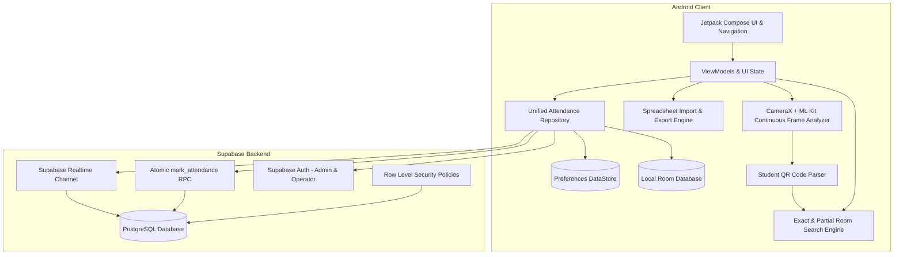
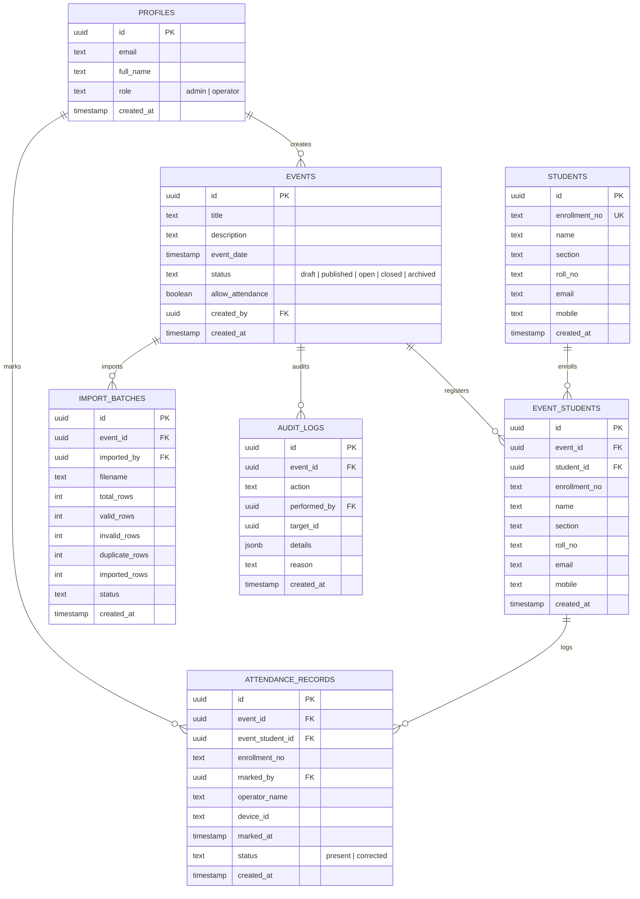

# Implementation Plan: Event Attendance System

Design, implement, test, and deliver a production-quality native Android application named **Event Attendance System** for college events, workshops, hackathons, and seminars, backed by **Supabase PostgreSQL** with real-time synchronization, indexed local Room search, continuous CameraX/ML Kit QR/barcode scanning, flexible Excel/CSV roster import with column mapping, and role-based security.

---

## User Review Required

> [!IMPORTANT]
> **Supabase Configuration & Credentials**:
> The application requires a Supabase project URL and anon public key. We will provide a clean template (`local.properties` / `supabase.properties`), validate missing credentials at runtime with a helpful setup screen, and include complete SQL migration scripts (`supabase/migrations/*.sql`) ready to execute in the Supabase SQL Editor.
> **Never commit service-role keys**: All client access uses the anon key with PostgreSQL Row Level Security (RLS) enforcing admin vs. operator permissions.

> [!IMPORTANT]
> **Student ID QR Code Parsing Rule**:
> ID cards encode pipe-delimited strings: `12025052002292|CSE|B.TECH|104202505200628`.
> The system strictly extracts **Field 1** (`12025052002292`) as the enrollment number, preserves leading zeros as text, trims whitespace, and matches against the event roster. Plain enrollment numbers without pipes are also accepted.

---

## 1. System Architecture & Key Components



### 1.1 Technology Stack & Versions
- **Platform**: Android (minSdk = 26, targetSdk = 35, compileSdk = 35)
- **Language**: Kotlin 2.0.21 with Kotlin DSL & Compose Compiler plugin
- **UI Framework**: Jetpack Compose with Material 3, Navigation Compose, Lifecycle-aware state collection
- **Local Persistence & Search**: Room 2.6.1 with SQLite FTS / indexed queries for sub-50ms keystroke search
- **Camera & Scanning**: CameraX 1.4.1 + Google ML Kit Barcode Scanning 17.3.0
- **Preferences & Keystore**: Android DataStore Preferences
- **Dependency Injection**: Hilt 2.51.1 with KSP
- **Networking & Backend**: Supabase Kotlin SDK (Postgrest, GoTrue/Auth, Realtime) via Ktor Android engine
- **Spreadsheet Processing**: Streaming `.xlsx` & `.xls` parser + RFC-4180 CSV parser/exporter
- **Feedback**: Android `ToneGenerator` for low-latency non-intrusive sound feedback, subtle Compose animated feedback states

---

## 2. Database Design & Supabase Backend

### 2.1 Core Schema & Constraints


### 2.2 Concurrency-Safe Atomic Attendance RPC (`mark_attendance`)
To prevent concurrent race conditions across multiple scanning devices:
- Stored procedure executes within a PostgreSQL transaction with row-level locks.
- Verifies:
  1. Event exists and `allow_attendance = true` and `status = 'open'` (or published/open).
  2. Student is in `event_students` for this `event_id`.
  3. Unique constraint `(event_id, enrollment_no)` on active attendance records prevents duplicates.
- Returns explicit status:
  - `SUCCESS`: Record inserted, returns authoritative timestamp & operator.
  - `ALREADY_MARKED`: Attendance already exists, returns previous timestamp & operator.
  - `STUDENT_NOT_REGISTERED`: Student is not enrolled in the event.
  - `EVENT_CLOSED`: Event does not permit attendance marking.
  - `PERMISSION_DENIED`: Caller lacks operator or admin permissions.

### 2.3 Row Level Security (RLS)
- **`profiles`**: Public read for authenticated users; updates restricted to self or admin.
- **`events`**: Public read for published/open events; create/update/archive restricted to `admin`.
- **`event_students`**: Operators can read students of assigned/open events; insert/update restricted to `admin`.
- **`attendance_records`**: Operators can read and insert for open events; corrections/deletions restricted to `admin` with trigger logging to `audit_logs`.
- **`audit_logs`**: Append-only; readable only by `admin`.

---

## 3. Local Indexed Search & Fast Attendance Workspace

### 3.1 Search Requirements
1. **Local Preloading**: When an event is selected, its roster is preloaded into Room SQLite with composite indices:
   - Index on `(event_id, enrollment_no)`
   - Index on `(event_id, name)`
2. **Keystroke Search (<50ms)**:
   - Evaluated as operator types via Kotlin Flow and Room DAO.
   - Zero network requests while typing.
3. **Exact-Match Safeguards**:
   - Enrollment number search: If operator types exact enrollment number and exactly 1 candidate matches -> trigger single one-time navigation event to Student Profile.
   - Name search: Case-insensitive, whitespace-trimmed. If query matches student's complete full name and exactly 1 candidate exists -> one-time navigation to Student Profile. If multiple students share the name, show candidate list.
   - Partial queries (e.g. typing prefix) never trigger auto-navigation even if only one match currently appears in the filtered list.
4. **Post-Attendance Reset**:
   - Clearing search query and resetting focus.
   - Remaining in the selected event workspace.

---

## 4. Continuous CameraX & ML Kit Scanner

### 4.1 Frame Analysis Pipeline
- CameraX `ImageAnalysis` analyzer with `STRATEGY_KEEP_ONLY_LATEST` for 60fps responsiveness.
- ML Kit `BarcodeScanning.getClient()` configured for `FORMAT_QR_CODE`, `FORMAT_CODE_128`, `FORMAT_CODE_39`, `FORMAT_EAN_13`.
- In-flight mutex lock: While an attendance request is in flight, incoming frames are ignored.
- Cooldown/re-arm timer: After scanning a code, prevent immediate re-trigger for 2.0 seconds unless code changes.

### 4.2 QR Code Parsing Specification (`StudentQrParser`)
- Delimiter: `|`
- Input: `12025052002292|CSE|B.TECH|104202505200628`
- Parsing logic:
  1. If contains `|`: split and take index 0.
  2. If single token without `|`: accept as plain enrollment number.
  3. Trim surrounding whitespace.
  4. Ensure string is non-empty. Never parse as Int/Long (preserves leading zeroes like `00123456789012`).
- Unit tests cover all 7 edge cases specified in prompt.

### 4.3 Instant Confirmation & Auto-Resume
- On `SUCCESS`:
  - Immediate audio tone via `ToneGenerator.startTone(TONE_PROP_ACK)`.
  - Display green success card overlay with student name, enrollment number, and checkmark.
  - Delay 1.0 second non-blocking (`delay(1000)`).
  - Dismiss overlay and automatically resume scanning loop without any button press.
- On `ALREADY_MARKED`:
  - Amber warning overlay: "Already Marked at [Time]".
  - Delay 1.2 seconds, resume.
- On `STUDENT_NOT_REGISTERED`:
  - Red error overlay: "Student not registered for this event".
  - Delay 1.5 seconds, resume.

---

## 5. Excel/CSV Import Engine with Flexible Column Mapping

### 5.1 Import Workflow
1. Select `.xlsx`, `.xls`, or `.csv` via `ActivityResultContracts.OpenDocument()`.
2. Off-thread parsing using coroutines (`Dispatchers.IO`).
3. Header detection & candidate column suggestion.
4. Mapping screen for 6 fields:
   - **Name**: Required (must be mapped)
   - **Enrollment Number**: Required (must be mapped, distinct from Name)
   - **Section**: Optional (can be "Not Mapped")
   - **Roll Number**: Optional (can be "Not Mapped")
   - **Email ID**: Optional (can be "Not Mapped")
   - **Mobile Number**: Optional (can be "Not Mapped")
5. Validation Engine:
   - Identifies blank required fields.
   - Identifies in-file duplicate enrollment numbers.
   - Identifies conflicts with existing event roster.
   - Formats enrollment numbers strictly as text (e.g. `0042` is not read as `42`).
6. Conflict resolution: `Skip Existing`, `Update Details`, or `Cancel`.
7. Atomic batch commit to Supabase + Room, recording `import_batches` metadata. Existing attendance records are never overwritten or reset.

### 5.2 Export Workflow
- Export attendance roster as CSV and Excel (`.xlsx`).
- Includes: Name, Enrollment Number, Section, Roll Number, Email, Mobile, Attendance Status, Marked At, Marked By Operator.

---

## 6. Proposed Project Structure

```
d:\Programming Project\Event Attendence system\
├── app/
│   ├── build.gradle.kts
│   └── src/
│       ├── main/
│       │   ├── AndroidManifest.xml
│       │   ├── java/com/eventattendance/app/
│       │   │   ├── EventAttendanceApp.kt
│       │   │   ├── MainActivity.kt
│       │   │   ├── core/
│       │   │   │   ├── designsystem/ (Theme, Typography, Colors, Components)
│       │   │   │   ├── config/ (SupabaseConfig, EnvironmentConfig)
│       │   │   │   ├── audio/ (SoundFeedbackManager)
│       │   │   │   ├── database/ (Room Database, DAOs, Entities, Converters)
│       │   │   │   ├── network/ (SupabaseClientProvider, RealtimeManager)
│       │   │   │   └── util/ (QrParser, Result, Formatters)
│       │   │   ├── data/
│       │   │   │   ├── model/ (Student, Event, AttendanceRecord, ImportBatch)
│       │   │   │   ├── repository/ (AttendanceRepository, EventRepository, etc.)
│       │   │   │   └── excel/ (ExcelParser, CsvParser, SpreadsheetImporter)
│       │   │   ├── domain/
│       │   │   │   └── usecase/ (MarkAttendanceUseCase, SearchStudentsUseCase, etc.)
│       │   │   ├── feature/
│       │   │   │   ├── splash/ (SplashScreen)
│       │   │   │   ├── onboarding/ (OperatorOnboardingScreen)
│       │   │   │   ├── auth/ (AdminLoginScreen)
│       │   │   │   ├── events/ (EventSelectionScreen, EventCreateEditScreen)
│       │   │   │   ├── workspace/ (AttendanceWorkspaceScreen, SearchResultsList)
│       │   │   │   ├── student/ (StudentProfileScreen)
│       │   │   │   ├── scanner/ (ContinuousScannerScreen, CameraPreview, Overlay)
│       │   │   │   ├── admin/ (AdminDashboardScreen, RosterScreen, AuditLogScreen)
│       │   │   │   ├── importexport/ (FileSelectScreen, ColumnMappingScreen, ValidationReportScreen)
│       │   │   │   └── settings/ (SettingsScreen)
│       │   │   └── navigation/ (AppNavigation, NavRoutes)
│       │   └── res/ (Icons, Drawables, Mipmaps, Values)
│       └── test/ (Comprehensive Unit Tests for QR parsing, Search, Validation, Import)
├── gradle/
│   └── wrapper/
├── supabase/
│   ├── migrations/
│   │   ├── 001_initial_schema.sql
│   │   ├── 002_rls_policies.sql
│   │   └── 003_rpc_functions.sql
│   └── seed.sql
├── docs/
│   ├── ARCHITECTURE.md
│   ├── SUPABASE_SETUP.md
│   └── USER_GUIDE.md
├── build.gradle.kts
├── settings.gradle.kts
├── gradle.properties
└── README.md
```

---

## 7. Verification Plan

### Automated Tests
1. **QR Code Parser Tests (`StudentQrParserTest`)**:
   - `12025052002292|CSE|B.TECH|104202505200628` -> extracts `12025052002292`
   - `00123456789012|CSE|B.TECH|123456` -> extracts `00123456789012` (preserves leading zeroes)
   - `12025052002292` -> plain enrollment accepted
   - `|CSE|B.TECH|104202505200628` -> rejected (empty field 1)
   - `|` -> rejected (invalid)
   - Malformed/empty payloads safely rejected
2. **Search Logic Tests (`SearchStudentsUseCaseTest`)**:
   - Exact unique enrollment match triggers direct navigation flag
   - Partial enrollment match returns filtered list, no direct navigation
   - Exact unique full-name match triggers direct navigation flag
   - Ambiguous/duplicate names return list, no auto-navigation
   - Case-insensitive and trimmed whitespace handling
   - No results and empty query states
3. **Excel/CSV Parsing & Validation Tests (`SpreadsheetValidatorTest`)**:
   - 6-field full mapping vs. 2-field minimum mapping (Name & Enrollment only)
   - Unmapped optional fields pass validation
   - Blank name or enrollment records flagged as errors
   - In-file duplicate enrollment numbers detected
   - String type enforcement for enrollment numbers (no scientific notation or truncated leading zeroes)
4. **Attendance State & Concurrency Tests (`MarkAttendanceUseCaseTest`)**:
   - First scan -> SUCCESS
   - Repeat scan -> ALREADY_MARKED with existing timestamp
   - Closed event -> REJECTED
   - Unregistered student -> REJECTED
5. **Gradle Build Verification**:
   - Execute `./gradlew test` to ensure all unit tests pass.
   - Execute `./gradlew assembleDebug` to verify complete Android compilation and APK packaging.

### Manual Verification Instructions
- Open the application on device/emulator.
- Walk through operator onboarding: enter operator name, verify stored in DataStore.
- Walk through event selection.
- In unified workspace: test enrollment search typing partial vs exact match.
- Verify scanner opens camera with scanning overlay, scan test QR code.
- Verify audio beep and ~1 second success banner, followed by auto-resume.
- In Admin mode: test Excel upload, column mapping with unmapped optional fields, conflict resolution preview, and export to CSV.
